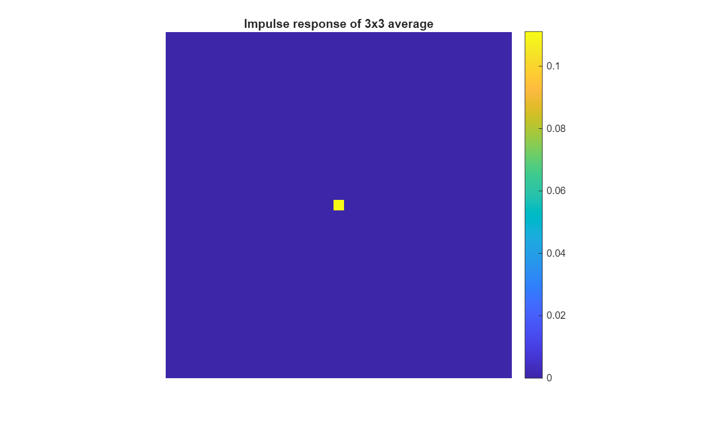
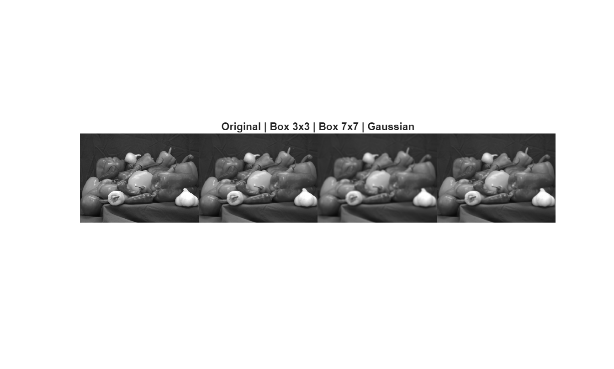
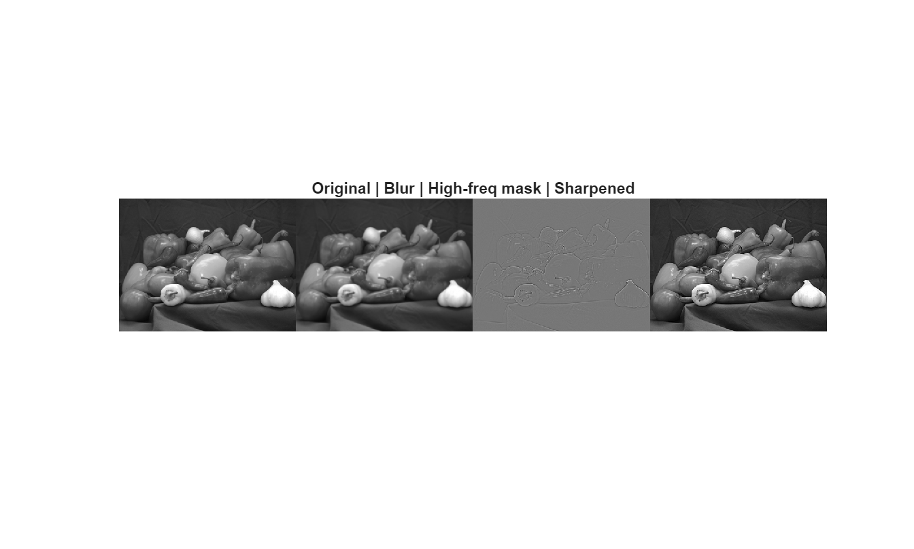
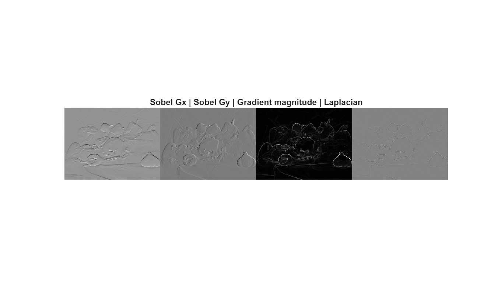
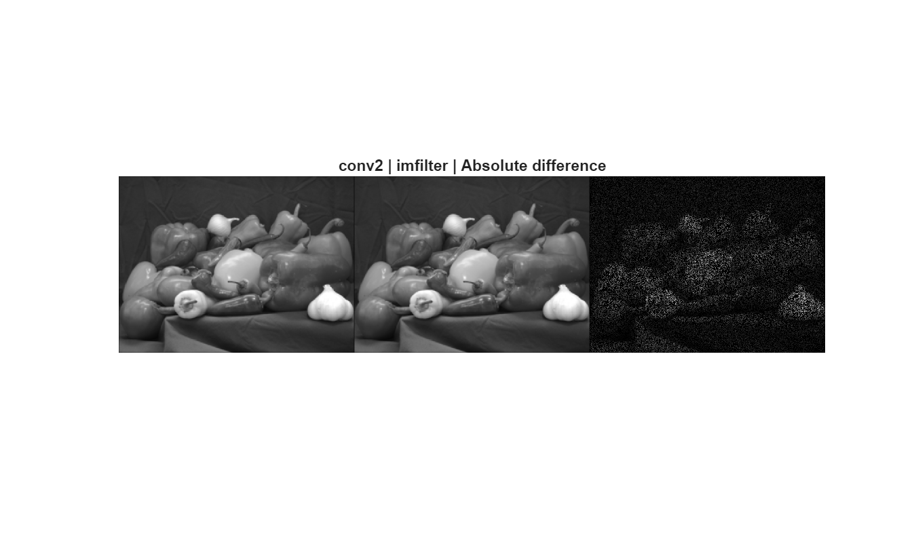
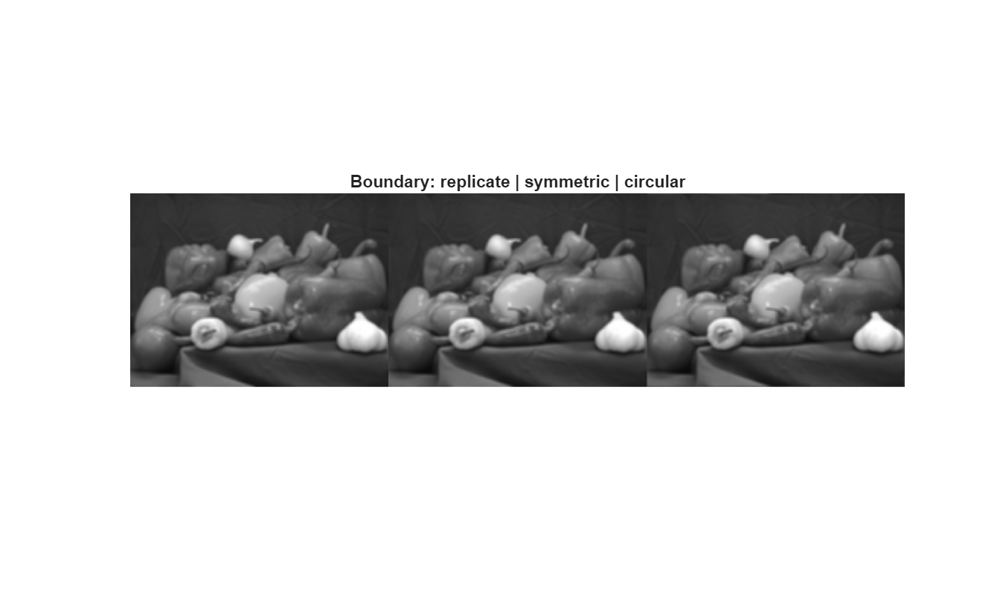

# Lab 2: 2D Convolution & FIR Filters

## Introduction

The purpose of this lab is to understand 2D convolution and FIR filters in image processing using MATLAB.

This lab covers impulse response, low-pass filters, sharpening, edge detection, convolution, and boundary handling.

## 1. Delta Image and Impulse Response

A delta image of size 101 x 101 was created with a value of 1 at the center and zero everywhere else.

A 3 x 3 averaging filter was applied using 2D convolution.

The output represents the impulse response of the averaging filter. Each value in the 3 x 3 kernel is equal to 1/9.

## 2. Low-Pass Filters: Box and Gaussian

Three low-pass filters were applied to the original grayscale image:

- 3 x 3 box filter
- 7 x 7 box filter
- Gaussian filter with sigma = 1.2

Low-pass filters smooth the image and reduce high-frequency details.

The 7 x 7 box filter produces more blur than the 3 x 3 box filter.

The Gaussian filter gives more weight to pixels near the center and produces smoother filtering.

## 3. Unsharp Masking

Unsharp masking was used to sharpen the image.

First, the original image was blurred using a Gaussian filter.

The blurred image was subtracted from the original image to obtain the high-frequency mask.

The mask was then added to the original image with a gain of 1.0.

This method increases the visibility of edges and fine details.

## 4. Edge Detection: Sobel and Laplacian

Sobel and Laplacian filters were applied to detect edges in the image.

The Sobel filter measures intensity changes in two directions. The gradient magnitude combines both directions.

The Laplacian filter detects rapid intensity changes using the second derivative.

These filters help identify object boundaries and important image details.

## 5. Correlation vs Convolution

Two MATLAB functions were used to perform convolution:

- conv2
- imfilter with the 'conv' option

The maximum difference between the two results was:

    3.33067e-16

This value is very close to zero. The small difference is caused by floating-point precision.

Both methods produced almost identical results.

The averaging kernel is symmetric, so flipping the kernel does not change its values.

## 6. Boundary Handling

Three boundary handling methods were tested:

- Replicate
- Symmetric
- Circular

Replicate extends the image using the nearest boundary pixel values.

Symmetric extends the image by reflecting pixel values at the boundaries.

Circular uses pixel values from the opposite side of the image.

These methods affect the filtering results near image edges and corners.

## 7. Short Reflections

### Question 1: Why is Gaussian preferred over a large box low-pass filter?

A Gaussian filter gives more weight to nearby pixels and less weight to distant pixels.

It has a smoother frequency response and generally produces fewer unwanted filtering artifacts than a large box filter.

### Question 2: What does separability do for computational cost?

Separability allows a 2D filter to be applied using two 1D filters.

For a 7 x 7 filter, direct filtering requires 49 multiplications per pixel.

Using two 1D filters reduces this to 7 + 7 = 14 multiplications per pixel.

This reduces computational cost and improves processing speed.

### Question 3: How do boundary modes change corners and edges?

Boundary modes determine which pixel values are used outside the image during filtering.

Replicate repeats the boundary pixels.

Symmetric reflects the image at its boundaries.

Circular connects opposite sides of the image.

Different boundary modes can produce different results near edges and corners.

## Conclusion

In this lab, I learned how 2D convolution and FIR filters are used in image processing.

I also learned how different filters can blur images, sharpen details, and detect edges.

The lab demonstrated the importance of separability and boundary handling in digital image processing.

The convolution comparison showed that conv2 and imfilter produced almost identical results.
