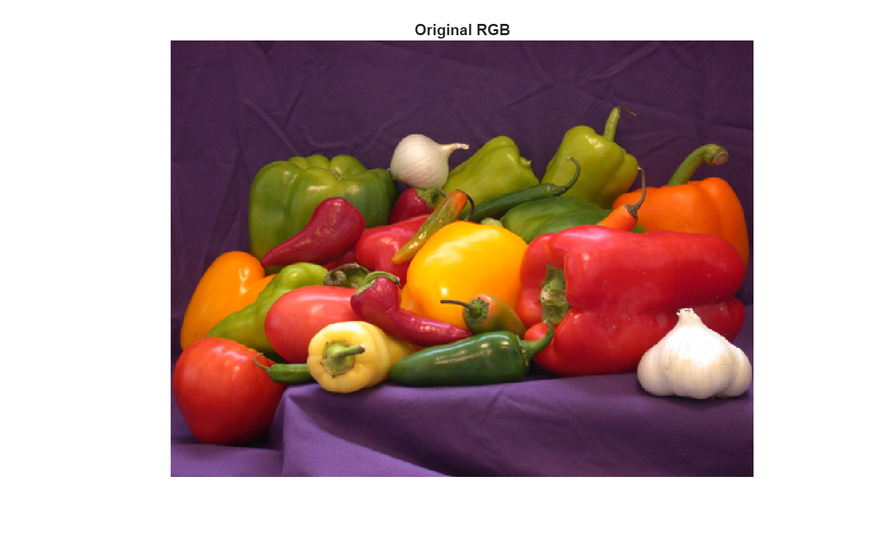
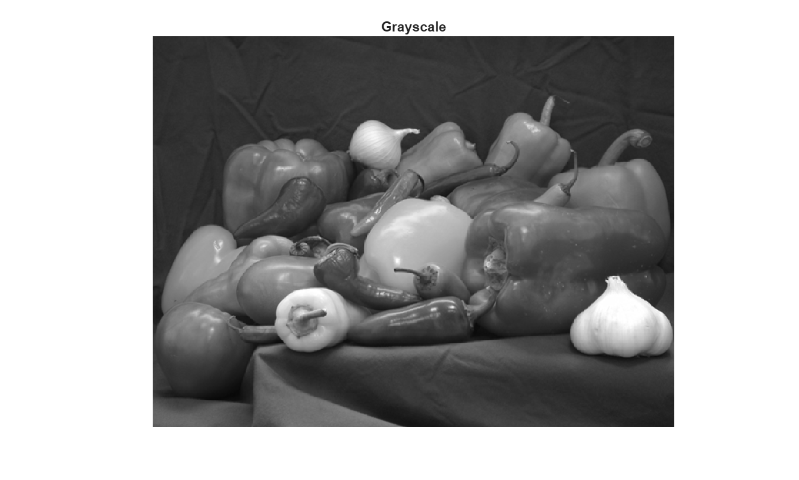
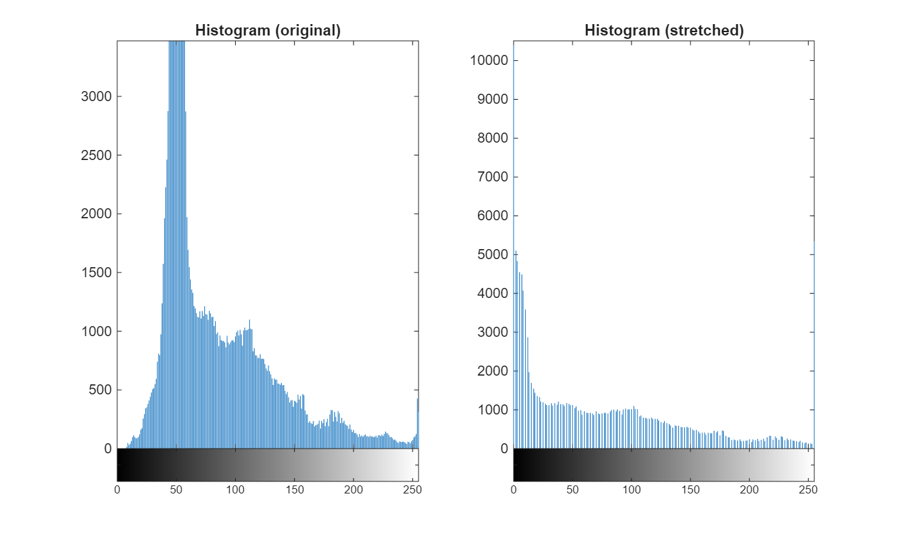
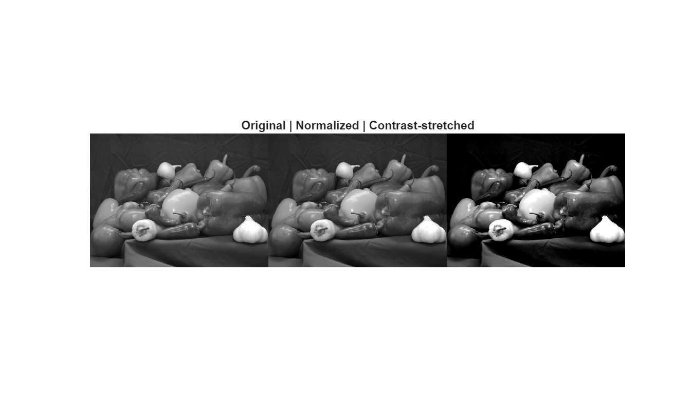
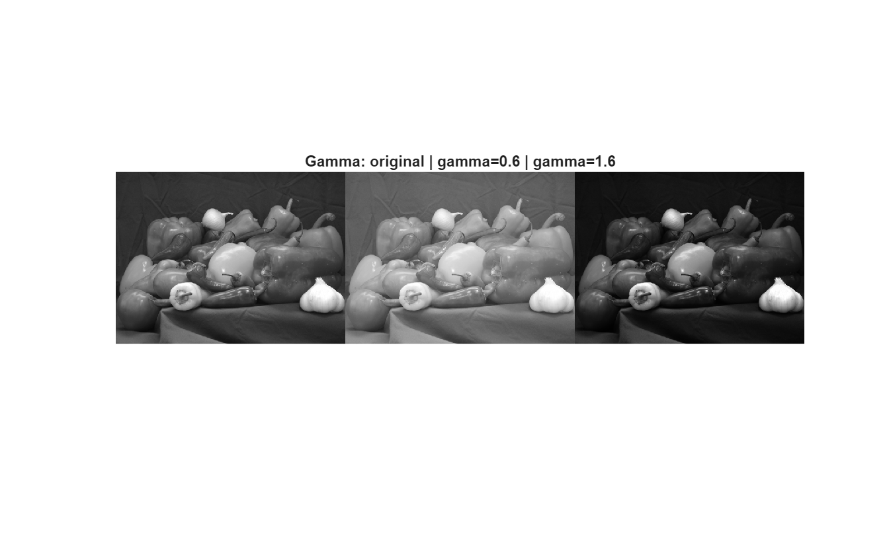
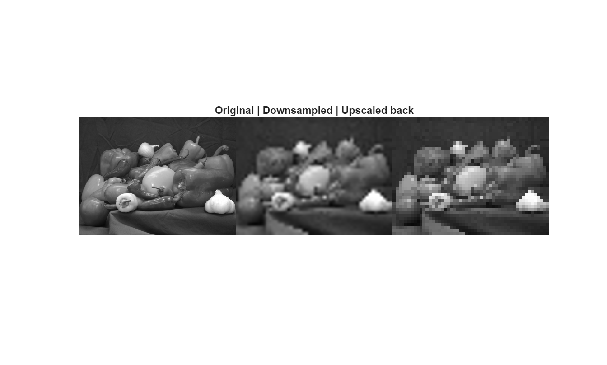

# Lab 1: Image as a 2D Signal

## Introduction

The purpose of this lab is to understand how digital images can be processed as 2D signals using MATLAB.

This lab covers grayscale conversion, quantization, dynamic range, histograms, contrast stretching, gamma correction, sampling, and aliasing.

## 0. Load and Inspect an Image

The peppers image was loaded into MATLAB and converted from RGB to grayscale.

### Original RGB Image

### Grayscale Image

### Image Information

| Property | Value |
|---|---|
| Data type | uint8 |
| Height | 384 pixels |
| Width | 512 pixels |
| Minimum intensity | 8 |
| Maximum intensity | 255 |

The grayscale image contains intensity values instead of three color channels.

## 1. Quantization and Dynamic Range

The image was quantized using three different bit depths.

| Bit depth | Intensity levels | Step size |
|---|---:|---:|
| 8-bit | 256 | 1 |
| 6-bit | 64 | 4 |
| 4-bit | 16 | 16 |

Reducing the bit depth reduces the number of available intensity levels. This can make smooth intensity changes look like visible steps or bands.

## 2. Histogram and Contrast Stretching

A histogram shows the distribution of pixel intensity values in an image.

Contrast stretching was applied to increase the difference between dark and bright areas.

### Histogram Comparison

### Image Comparison

Normalization scales the intensity values to a standard range. Contrast stretching expands the selected intensity range and can make image details easier to see.

## 3. Gamma Correction

Gamma correction is a nonlinear method used to change image brightness.

Three images were compared:

- Original image
- Gamma = 0.6
- Gamma = 1.6

A gamma value below 1 makes the image brighter. A gamma value above 1 makes the image darker.

Unlike contrast stretching, gamma correction changes intensity values nonlinearly.

## 4. Sampling and Aliasing

The original image was resized to 10% of its original size using nearest-neighbor interpolation.

The small image was then resized back to its original dimensions.

Downsampling reduces the number of pixels and removes spatial details. Upsampling cannot recover the original lost information.

Aggressive downsampling without proper filtering can also introduce aliasing artifacts.

## 5. Short Reflections

### Question 1: How does bit depth affect visible banding?

Lower bit depth means fewer intensity levels. This makes intensity transitions less smooth and can cause visible banding or posterization.

### Question 2: How does contrast stretching change the histogram and visibility of details?

Contrast stretching spreads the selected intensity values over a wider range. This increases the difference between dark and bright areas and can make details more visible.

### Question 3: Why does aggressive downsampling cause aliasing?

According to the Nyquist sampling theorem, the sampling frequency must be at least twice the highest signal frequency.

When an image is aggressively downsampled without proper low-pass filtering, high-frequency spatial details may appear as incorrect patterns or distortions.

## Conclusion

In this lab, I learned how digital images can be represented and processed as 2D signals.

I also learned how bit depth, contrast, gamma correction, and spatial sampling affect image quality.

MATLAB was used to apply and compare these image processing techniques.
