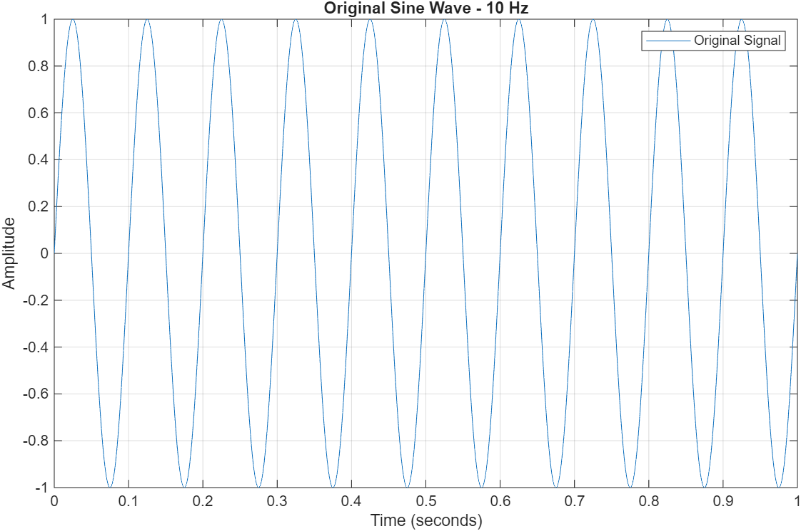
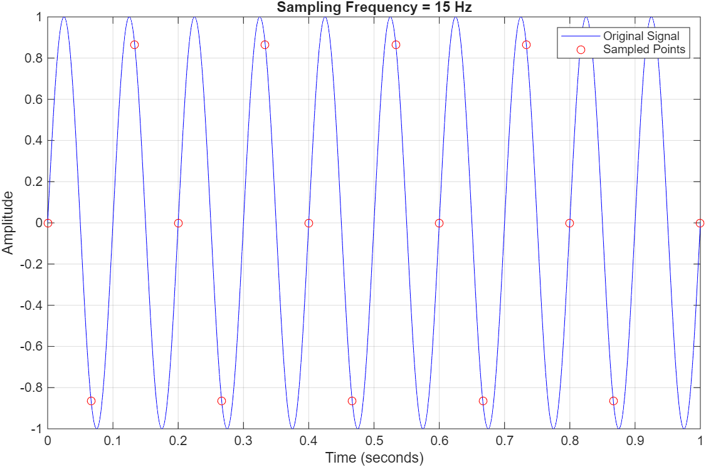
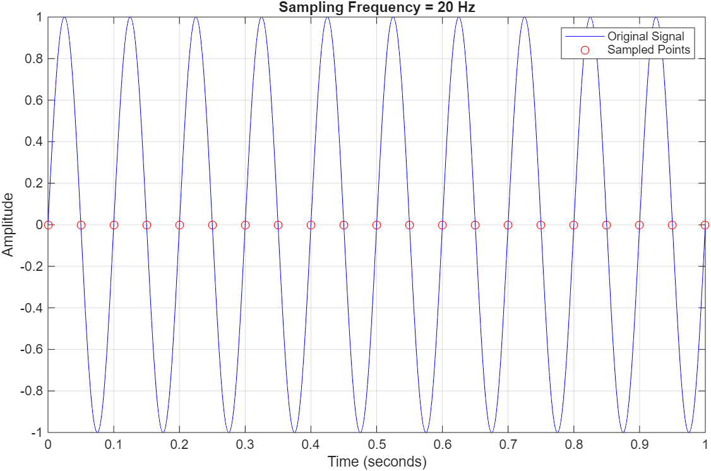
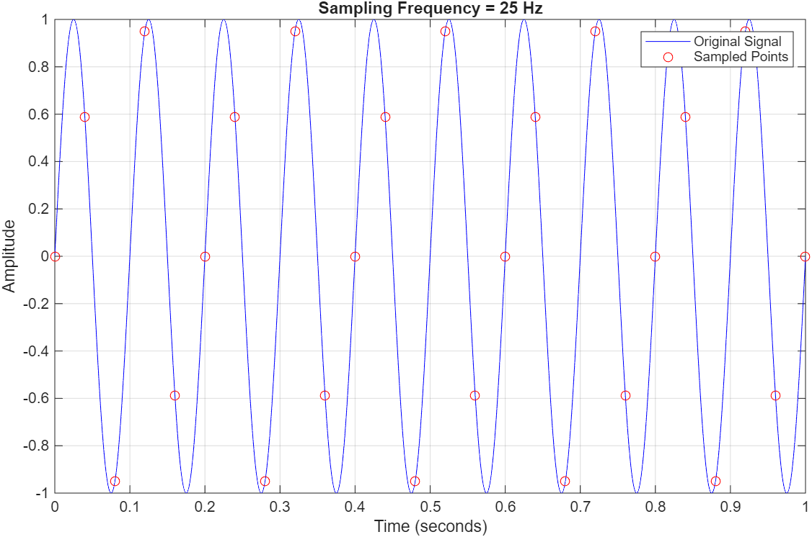
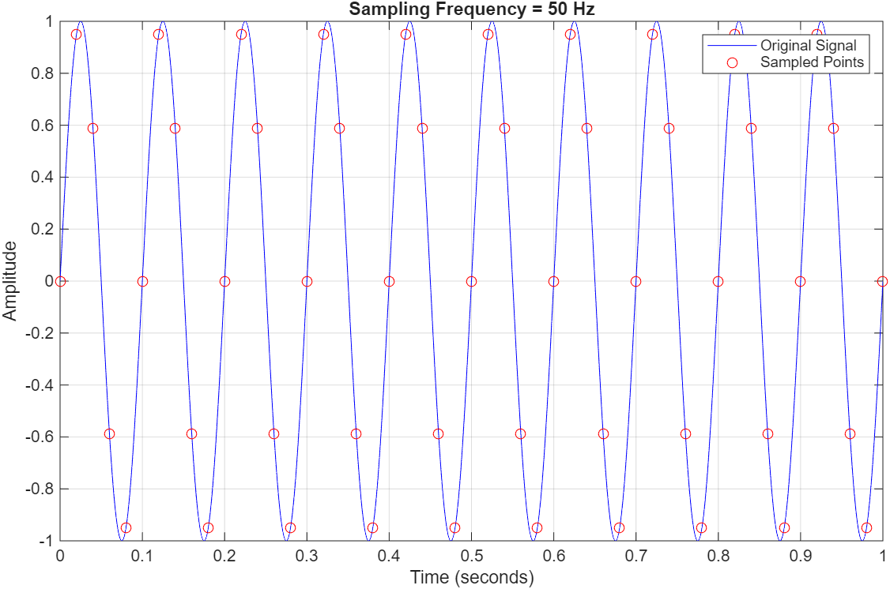
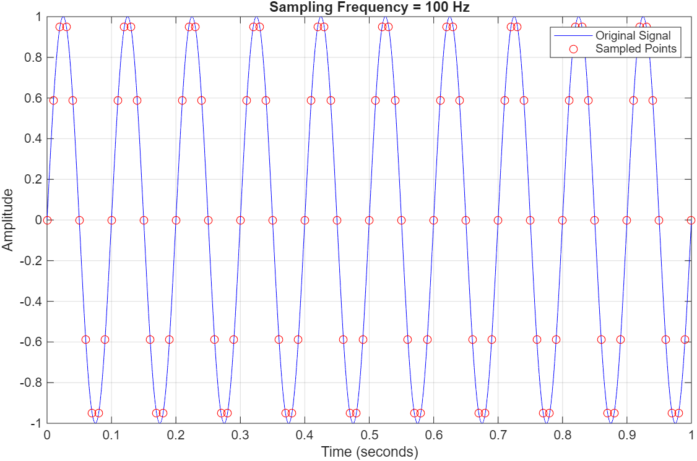

# Lecture 02 – Sampling and Aliasing

## Objective

The objective of this assignment is to investigate how different sampling frequencies affect a 10 Hz sine wave in MATLAB. I compared the original signal with sampled points, studied the Nyquist Sampling Theorem, and observed aliasing. The experiment also helped me choose a suitable sampling frequency for an engineering application.

## Original Signal

I generated a sine wave with a frequency of 10 Hz, an amplitude of 1, and a duration of 1 second. I used a time step of 0.0001 seconds to make the original signal look smooth.

## Nyquist Analysis

The highest frequency in the original signal is:

`fmax = 10 Hz`

According to the Nyquist Sampling Theorem, the sampling frequency should be at least twice the highest signal frequency:

`fs >= 2 × fmax = 2 × 10 = 20 Hz`

The theoretical Nyquist rate is **20 Hz**. However, sampling exactly at 20 Hz is not reliable for this sine wave: the sampling instants coincide with its zero crossings, so all sampled values are approximately zero. In practice, a sampling rate above the Nyquist rate is preferred.

**Which sampling frequencies satisfy the Nyquist criterion?**

- **15 Hz:** Below the Nyquist rate; does not satisfy the criterion.
- **20 Hz:** Exactly at the theoretical boundary; not sufficient for reliable reconstruction in this example.
- **25 Hz:** Above the Nyquist rate.
- **50 Hz:** Above the Nyquist rate.
- **100 Hz:** Above the Nyquist rate.

**Is sampling exactly at the Nyquist rate recommended?**

No. Sampling at the exact boundary can give ambiguous or unusable samples depending on the signal phase. Real systems also need room for practical filters and measurement uncertainties.

## Results

I plotted the original 10 Hz sine wave and overlaid sampled points at five different sampling frequencies.

| Sampling frequency | Sampling period | Observation |
| --- | --- | --- |
| 15 Hz | 0.0667 s | Too few samples; the 10 Hz signal aliases to an apparent 5 Hz signal. |
| 20 Hz | 0.0500 s | All sample values are approximately zero in this example. |
| 25 Hz | 0.0400 s | The samples represent the 10 Hz signal, but there are only 2.5 samples per cycle. |
| 50 Hz | 0.0200 s | Five samples per cycle show the waveform more clearly. |
| 100 Hz | 0.0100 s | Ten samples per cycle give a denser representation, but require more data. |

### Sampling figures

**15 Hz**

**20 Hz**

**25 Hz**

**50 Hz**

**100 Hz**

## Aliasing Discussion

Aliasing occurs at **15 Hz** because the sampling frequency is below twice the original 10 Hz signal frequency. The samples can look like a lower-frequency signal, so the original frequency cannot be identified correctly from the samples alone. In this case, the apparent alias frequency is 5 Hz.

At **20 Hz**, the sampling frequency is exactly the Nyquist rate. For the sine wave used in this experiment, the samples fall on the zero crossings. This is a boundary problem rather than the same below-Nyquist aliasing seen at 15 Hz.

At **25 Hz, 50 Hz, and 100 Hz**, the sampling frequencies are above the Nyquist rate for this ideal 10 Hz signal. Higher sampling rates give more points per cycle and make the waveform easier to visualize.

For this experiment, I recommend **50 Hz** because it provides five samples per cycle with less data than 100 Hz. In a real machine monitoring system, the choice must also consider the highest vibration frequency of interest, anti-aliasing filters, and measurement accuracy.

## Engineering Recommendation

I recommend **50 Hz for the given 10 Hz demonstration signal**. It is five times the signal frequency, so the sampled points show the shape more clearly than at 25 Hz, while producing only half as much data as 100 Hz. This can reduce storage and processing requirements.

For an industrial vibration monitoring system, I would first check the full frequency range that the sensor needs to measure. I would then select a sampling rate with enough margin above twice the highest relevant frequency and use an analog anti-aliasing filter before sampling. A 50 Hz sampling rate should not automatically be used for machines that produce higher-frequency vibrations.

## AI Usage

**AI Tool Used:** ChatGPT

**Prompt(s):**

- "Help me complete Lecture 02 – Sampling and Aliasing in MATLAB step by step."
- "Explain how to sample a 10 Hz sine wave at 15, 20, 25, 50, and 100 Hz and compare the results."
- "Create a complete README for my Lecture 02 assignment."

**Summary of AI Response:**

ChatGPT suggested MATLAB code to generate the original signal and overlay sampled points using subplots. It also explained the Nyquist rate, aliasing, and the differences between sampling frequencies, and helped organize this README.

**What I Modified:**

I organized the MATLAB tasks in one script and used the assignment's sampling frequencies. I did not make additional changes to the suggested sampling code before testing it. I reviewed the explanations and selected 50 Hz as the recommendation for this demonstration.

**How I Verified the Results:**

I ran the MATLAB code and inspected the figures. The original plot showed 10 complete cycles in one second. The sampling plots showed fewer points at 15 Hz and more points at 50 Hz and 100 Hz. At 20 Hz, the sampled points were approximately zero, as predicted by the sine-wave equation. I also checked the Nyquist calculation: `2 × 10 = 20 Hz`.

## Files

- `Lecture02_sampling_aliasing.m` – MATLAB script
- `original_signal.png` – Original 10 Hz sine wave
- `sampling_15Hz.png` – Sampling at 15 Hz
- `sampling_20Hz.png` – Sampling at 20 Hz
- `sampling_25Hz.png` – Sampling at 25 Hz
- `sampling_50Hz.png` – Sampling at 50 Hz
- `sampling_100Hz.png` – Sampling at 100 Hz

## Conclusion

This assignment helped me understand how sampling frequency affects signal representation. I learned that sampling below the Nyquist rate causes aliasing and that sampling at the exact boundary can also be problematic. A higher sampling frequency can improve visualization, but it also increases the amount of data to process.
