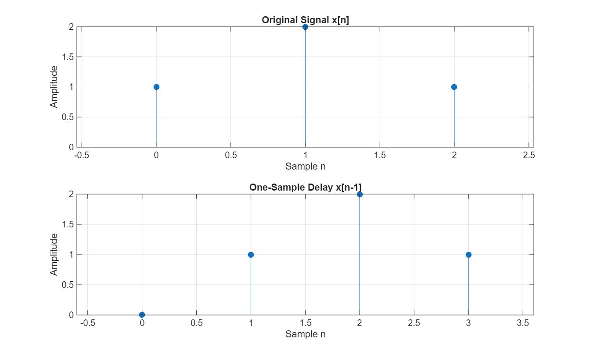
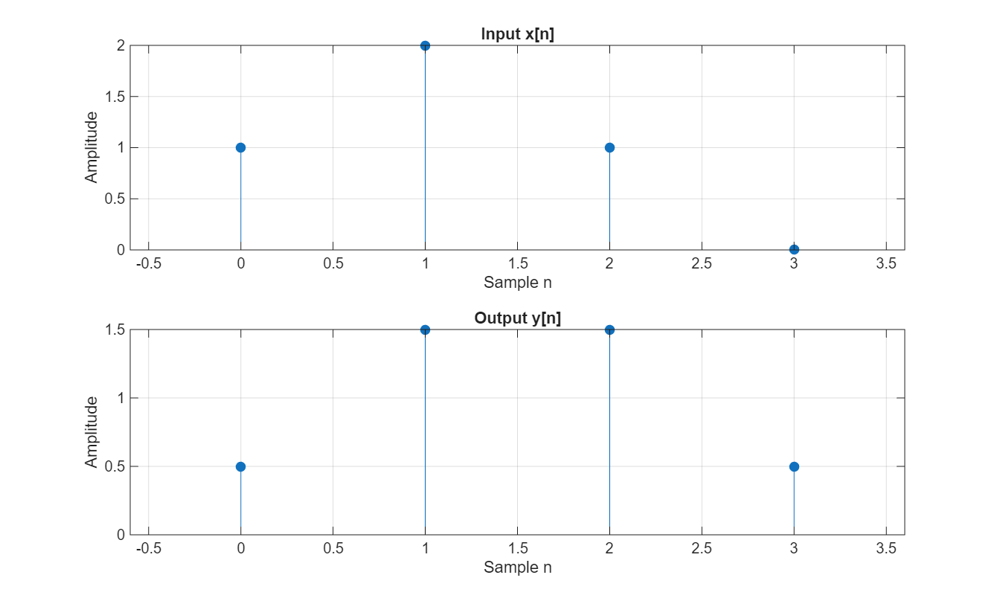
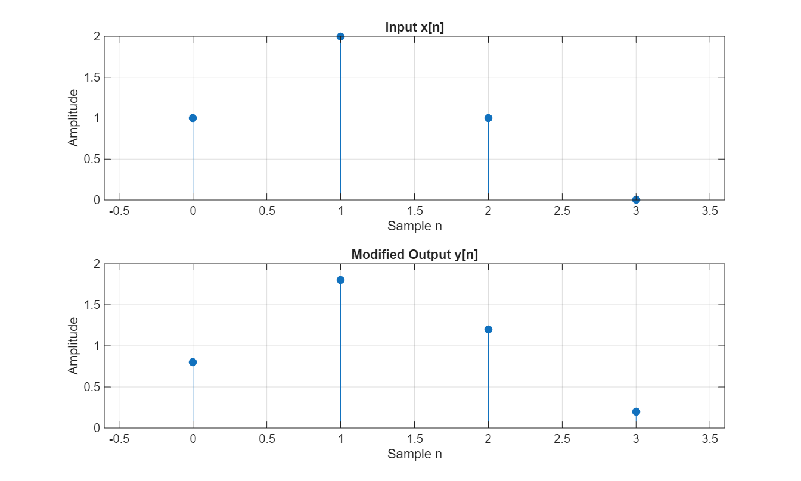

# Z-Transform and Digital Signal Processing

## Introduction

The purpose of this assignment is to understand the Z-transform, signal delay, and how a simple digital system processes an input signal using MATLAB.

## Part 1: A Signal and Its Z-Transform

The original signal is:

x[n] = [1, 2, 1]

The Z-transform is:

X(z) = 1 + 2z⁻¹ + z⁻²

### Question 1

Identify the sample represented by each term in X(z).

| Term | Sample |
|---|---|
| 1 | x[0] = 1 |
| 2z⁻¹ | x[1] = 2 |
| z⁻² | x[2] = 1 |

Each term represents the value and position of a sample in the original signal.

### Question 2

The delayed signal is:

xDelayed = [0, 1, 2, 1]

The Z-transform of the delayed signal is:

Xd(z) = z⁻¹ + 2z⁻² + z⁻³

### Question 3

Delaying the signal by one sample moves all samples one position to the right without changing their values.

This adds one negative power of z to each term. Therefore, the original Z-transform is multiplied by z⁻¹.

Xd(z) = z⁻¹ X(z)

### MATLAB Results

The following figure shows the original signal and the delayed signal.

## Part 2: A System with One Sample Delay

The system equation is:

y[n] = 0.5x[n] + 0.5x[n-1]

The transfer function is:

H(z) = 0.5 + 0.5z⁻¹

### Question 4

Manual calculations:

- y[0] = 0.5(1) + 0.5(0) = 0.5
- y[1] = 0.5(2) + 0.5(1) = 1.5
- y[2] = 0.5(1) + 0.5(2) = 1.5
- y[3] = 0.5(0) + 0.5(1) = 0.5

Comparison with MATLAB:

| Sample | Manual Result | MATLAB Result |
|---|---:|---:|
| y[0] | 0.5 | 0.5 |
| y[1] | 1.5 | 1.5 |
| y[2] | 1.5 | 1.5 |
| y[3] | 0.5 | 0.5 |

The manual calculations match the MATLAB results.

### Question 5

The vector b = [0.5 0.5] represents the two coefficients of the transfer function.

The first coefficient represents the current input x[n].

The second coefficient represents the previous input x[n-1].

Both inputs have equal influence on the output.

### MATLAB Results

The following figure shows the input and output signals.

### Question 6

The modified transfer function is:

H(z) = 0.8 + 0.2z⁻¹

The coefficients were changed to:

b = [0.8 0.2]

The new system equation is:

y[n] = 0.8x[n] + 0.2x[n-1]

The MATLAB output is:

y = [0.8, 1.8, 1.2, 0.2]

The current input has more influence on the output because its coefficient is 0.8, while the previous input has a coefficient of 0.2.

### Modified System Results

## Conclusion

In this assignment, I learned how the Z-transform represents discrete-time signals and how a one-sample delay affects the signal.

I also learned how to use the MATLAB filter function and how changing the system coefficients affects the output.

The MATLAB results matched the manual calculations.
